# Table layouts: resize, remembered state, saved layouts, column menu, pinned columns

Date: 2026-10-27
Status: design, not implemented
Issue: #943 (absorbs #740)
Reference: PR #944 (`2026-10-06-saved-table-views-design.md` on `feat/saved-table-views`). This
spec keeps its core design and replaces its delivery plan. Where the two disagree, this one wins.

## Problem

Every CRM list table forgets what the user did to it. Column visibility and order live in the
Laravel session, so they reset when the session expires. Sort, filters, search and page size are
not remembered at all. Issue #740 carries the repro: hide `Created By` on People, come back after the session
lifetime, and the column is back.

Column widths are worse. `asmit/resized-column` keeps its database write behind a flag we never
set, and the `table_settings` table it targets exists in neither the local nor the production
database. Widths live in the session only.

There is also no way to keep two layouts of the same table ("Hot leads", "Renewals this month")
and switch between them, and no way to share one with the workspace.

## Goals

- A member's last table state comes back on their next visit, on any device, per workspace.
- Members save named layouts of a table, switch between them, and may share them with the
  workspace.
- Column widths are stored, per member, and the resizer is our own code.
- Each column header offers sort, move, hide and (last) pin from one menu.
- Columns can be reordered by dragging their headers.
- Columns can be pinned to the left edge and stay visible while the table scrolls sideways.

## Non-goals

- Remembered state, layouts, pins or resizing for relation managers, the activity log, import
  history, the Livewire settings tables and the SystemAdmin panel. From phase 2 on, the app
  panel's tables keep no column state in the session, so hidden and reordered columns reset on
  each page load. Page size stays in the session. The SystemAdmin panel keeps Filament's default
  behaviour.
- A workspace-wide default layout that an Admin forces on every member.
- Pinning to the right edge.
- Widths that change with the active layout. Widths stay per member and per table.
- A separate package. See Decisions.
- Remembering the list, board or cards choice of the view switcher. It has the same session-only
  problem and gets its own issue.

## Anti-goals

The feature fails, even if every test passes, when:

- The layouts control says a layout is active while the table shows something else. The
  "(modified)" state exists to prevent exactly this.
- A deleted custom field breaks a saved layout or a member's table. State heals itself (see
  Self-healing).
- Opening a table writes to the database. Writes happen only when the member changes something,
  or once a session when their default layout replaces a different saved state.
- One workspace's custom field columns leak into another's state.
- A menu item is shown before the phase that makes it work.

## Decisions

| Decision | Chosen | Rejected |
|---|---|---|
| Delivery | Five phases, one PR each, each branched from `main` after the phase it needs has merged | One PR with three commits (#944); stacked branches |
| Where the code lives | `app/`, in the folders listed under Code layout | A `packages/` module: the feature has no panel, routes or lifecycle of its own, and every part depends on `App` models and enums |
| Row key | `entity`, a `CrmEntity` value | The list page class name (#944): a class rename would orphan every saved row |
| Layouts control placement | Table toolbar, after search and before the filter trigger | Left of search (the first build); page header beside Import / Export (#944's default) |
| Sharing | Private layouts, plus share to the workspace; Admins may edit or delete a shared layout | Private only; shared but owner-only |
| What a layout stores | Columns (visibility, order), sort, filters, search, column searches, grouping, page size, pins | Widths: they stay per member and per table |
| Auto-save | Yes: the last state persists per member, and saved layouts sit on top | Saved layouts only |
| Resize | Port the Maxforms implementation | Keep `asmit/resized-column`; reimplement a minimal resizer |
| Resizer API | A `Table::resizableColumns()` macro, typed for PHPStan by `stubs/Filament.stub` | A static `ResizableColumns::apply($table)` call; a macro silenced by a `phpstan.neon` ignore |
| Column widths | Every data column has an exact width, and the actions column takes the space left over | Maxforms' elastic columns (see "Why columns are not elastic, for now") |
| Name | "Layout": Save layout, My layouts, Delete layout. Models `TableLayout` and `TablePreference` | "View": the list, board and cards switcher (`RemembersViewMode`) already owns that word, and `architecture.md` allows one word per concept |
| Default page size | 25, already set on `main` (`AppPanelProvider::DEFAULT_PAGINATION_PAGE_OPTION`) | 10 |

## Prior art

#944 reviewed seven Filament plugins on 2026-09-17. None fits.

| Package | Stores | Workspace-aware | Verdict |
|---|---|---|---|
| kisame76/filament-db-table-state | all session table state, automatically | no | beta, a DB read per table request, swallows errors |
| Advanced Tables (archilex) | named views, favorites, shared views, approval | yes | paid and closed source; only worth it if curated team views become a product goal |
| wotz/filament-table-filter-presets | named filter and column presets | no | v0.x, but its "set as default" and remount-to-apply ideas are worth borrowing |
| hydrat/filament-table-layout-toggle | grid versus table layout | no | different problem; its storage-driver interface is the only idea |
| Bostos/reorderable-columns, KozSuper/Filament-Table-Views, guiu/filament-filter-presets | column order or named views | no | Filament v3 only, stale |

In-house wins on three counts. Workspace scoping is mandatory here and absent from every free
package. Our custom field columns differ per workspace. And the write path has to go through an
action class to satisfy `EloquentWriteOutsideActionRule`.

## Phases

Phases 1 to 3 are what #943 promises. Phases 4 and 5 are in scope and follow them. Each phase
is one PR against `main`. A phase branches from `main` only once every phase in its Needs column
has merged, so no PR is stacked on another. Each one is shippable on its own.

| Phase | Ships | Needs |
|---|---|---|
| 1. Resize port | Maxforms resizer on all five tables; `asmit/resized-column` removed | none |
| 2. Remembered table state | `table_preferences`; every table setting, widths included, comes back per member and workspace | 1 |
| 3. Saved layouts | `table_layouts`; layouts control in the toolbar; sharing; "(modified)" state | 2 |
| 4. Column menu and reorder | Header menu with sort, move and hide; drag headers to reorder | 2 |
| 5. Pinned columns | "Pin to left" in the menu; sticky columns; pins saved in state and in layouts | 1, 2, 4 |

The five tables are `ListCompanies`, `ListPeople`, `ListOpportunities`, `ManageTasks` and
`ManageNotes`.

### Phase 1: Resize port

Replace `asmit/resized-column` with the Maxforms implementation at today's behaviour: widths are
remembered in the session, as they are now. Phase 2 moves them to the database.

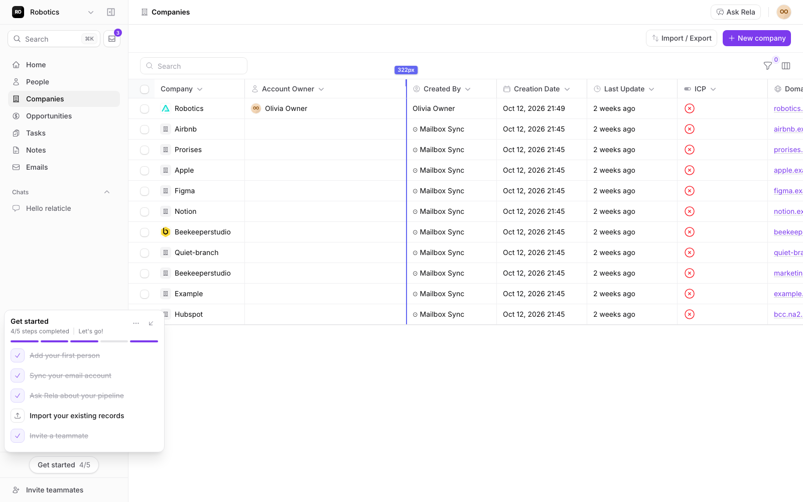
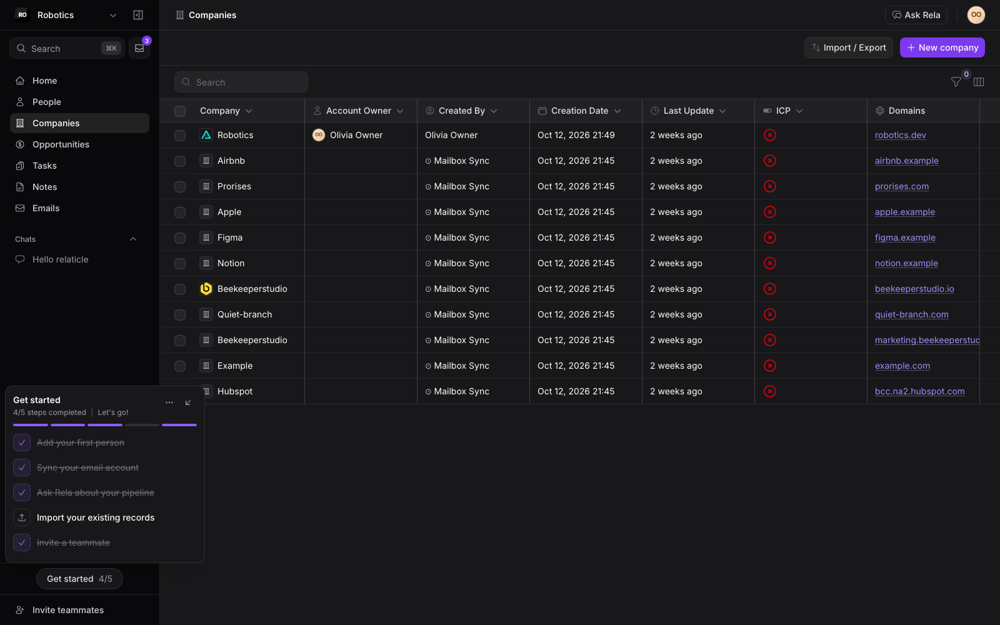

Source: the `maxforms-resizable` extract (Maxforms commit `de1c8eeb9`), kept beside the
repository. Its README names each file.

- `HasResizableColumns` trait to `app/Filament/Tables/Concerns/`. Drop the `TableSetting` model
  and its migration: keep the session write only. Keep the server-side clamp of 40 to 1000 px,
  because the Livewire action accepts any payload.
- The Maxforms macro becomes `ResizableColumns` in `app/Filament/Tables/`. It gives every column
  its saved width, else its `->width()`, else 180 px, and owns the 40 and 1000 px bounds.
  `MacroServiceProvider` exposes it as `Table::resizableColumns()`.
- `stubs/Filament.stub` declares the macro on `Table` and tells PHPStan that `$this` inside a
  Filament macro is the table. Filament's `macro()` lacks the annotation Laravel's carries.
  `Table` has a magic `__call()`, so PHPStan accepts any method name on it: the tests catch a
  misspelled call, not PHPStan.
- The resize half of `submissions.js` (from the "resizableColumn Alpine component" banner to
  the end, minus the expandable-text wiring) to `resources/js/filament/resizable-columns.js`,
  registered with `FilamentAsset::register()` like `payload-guard.js`. Commit the published copy
  under `public/js/app/`. It already survives our `->spa()` panel, so keep these three hooks:
  `livewire:navigated` sets up the table after an SPA page switch, the `morphed` Livewire hook
  restores the handles a re-render strips, and the Alpine data factory registers immediately
  when Alpine is running, else on `alpine:init`.
- The resize rules of `submissions.css` (those targeting `fi-ta-resizable-*`,
  `data-resizable-*` and `column-resize-*`) folded into `resources/css/filament/app/theme.css`.
- Remove the package from `composer.json`, `ResizedColumnPlugin` from `AppPanelProvider`, and
  `Asmit\ResizedColumn\HasResizableColumn` from the five pages.
- Re-derive or delete the z-index workaround under "Dropdowns" in `theme.css`. It exists only
  because asmit lifts the table toolbar to z-index 21.

Learned from the spike on `spike/maxforms-resize`:

- The ported CSS hardcodes Tailwind's blue-gray and indigo. Replace every colour with the
  panel's variables (`--gray-*`, `--primary-*`). The spike's header row came out navy in dark
  mode until this was done.
- The JS rewrites each cell's `style` attribute on every measuring pass, so nothing else may set
  inline styles on table cells. Phase 5 depends on this.
- The ported comments carry em-dashes, which `tests/Arch/ConventionsTest.php` fails, and run
  past the two-line cap. Rewrite them during the port.
- `->resizableColumns()` reads the table's columns, so `HasCustomFieldColumns::table()` calls it
  last, and custom field columns get handles too. A page opts in with `use HasResizableColumns`.
- The panel scrolls inside `.fi-layout`, not the document. The Maxforms sticky head pinned to the
  page, so the port pins it to the nearest scrolling ancestor through a named scroll timeline.
- A width is saved when the drag ends, and the trait re-stamps the columns after saving. A sort
  sent in the same request otherwise renders the old width.
- `wire:navigate` replaces the whole body, so the width badge is recreated when it is detached.
- The resizer reserves a fixed width for row actions, which assumes they are wrapped in an
  `ActionGroup`. Confirm this on all five tables.

Done when:

- All five tables resize by drag, and a double-click on a handle fits the column to its content.
- A width survives a reload within the session.
- Dropdowns, row menus, the sticky table head and SPA navigation between the five tables work in
  Chromium and WebKit, light and dark.
- `asmit/resized-column` is gone from `composer.json` and `composer.lock`.
- A drag changes a column by the width the badge shows, on a narrow screen and on a wide one.

#### Why columns are not elastic, for now

Maxforms split columns in two. A fixed column, such as a timestamp, had an exact width. An
elastic column had only a `min-width`, and the elastic columns shared the space left over.

That split breaks resizing on a wide screen. The table uses `table-layout: fixed`, and browsers
ignore `min-width` on table cells in that mode. When the table fits the screen, dragging an
elastic column changed its saved width and nothing else. The guideline and badge showed, but the
column did not move. On a narrower screen the table overflows and every column is exact, which
is why a 1440 px test passed and a real wide monitor failed.

Maxforms carries the same bug, read from its source rather than run. Its submissions table has a
column per form field, so it nearly always overflows and the bug rarely shows. Our CRM tables
have five to eight columns and usually fit the screen, so here it showed at once.

Phase 1 therefore gives every data column an exact width. The actions column takes the space
left over, so the table still reaches the right edge and the row menu stays there. The cost is
an empty band before the row menu on a wide screen.

Considered and set aside:

| Option | What happens | Why not now |
|---|---|---|
| A filler column: one `->grow()` column takes the spare space | The chosen column stretches and every other column stays exact | Dragging the filler itself shows no change while it fills the screen. Tried on Companies, then held back |
| A resized elastic column turns exact | Untouched elastic columns stretch, and a dragged one keeps the dragged width | More logic in the script, and the other columns visibly shrink while you drag |
| Spare space shared by every column | Every column stretches in proportion | A column grows by a different amount than the badge shows |

Revisit this when the empty band on wide screens draws complaints. The filler column is the
smallest next step: `->grow()` on the title column, with the actions column back at 64 px.

### Phase 2: Remembered table state

Everything a member does to a table is saved per member, per workspace and per table, and comes
back on their next visit on any device. No new UI. Only column state and page size are remembered
today, and only within a session; the rest is new.

- Turn off Filament's column persistence with `persistColumnsInSession(false)` in
  `AppPanelProvider`, on every app panel table (see Filament internals). Of the seven session
  flags only columns and page size default to on. Page size stays in the session, and on the five
  pages the row's page size wins because mount seeds it first.
- Add `table_preferences` and `TableStateData` (see Domain model).
- Add the `PersistsTableState` trait to the five pages, through `HasCustomFieldColumns`:
  1. `loadTableColumnsFromSession()`: return the stored column state, else the default.
  2. `mountInteractsWithTable()`: call the parent, then seed sort, filters, search, column
     searches, grouping and page size from the row. Each is guarded on `blank()`, so a shared
     URL wins over saved state.
  3. `dehydrate()`: hash the current state, compare it with the hash recorded at the end of the
     previous request (the first request records it without writing), and persist
     through `SaveTablePreference` when it changed. One writer, one write per request.
- Widths move from the session to the row. The phase 1 width action keeps its clamp and only
  assigns the property; the dehydrate sync persists it. `#[Renderless]` skips rendering, not
  dehydration.

Done when:

- A hidden column, a reordered column, a width, a sort, a filter and a page size each survive a
  logout and login, for a member with no default layout.
- The same member in a second workspace has separate state for the same table.
- Opening a table without changing anything writes nothing, except the first open of a session
  that replaces a different saved state with the member's default layout.
- A state that names a deleted custom field loads without error (see Self-healing).

### Phase 3: Saved layouts

A member saves the current table as a named layout, switches between layouts, and may share a layout
with the workspace.

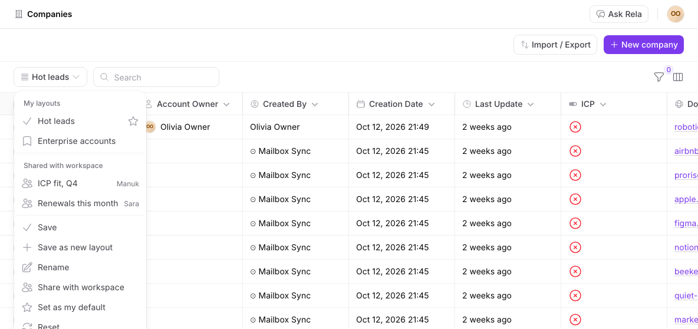
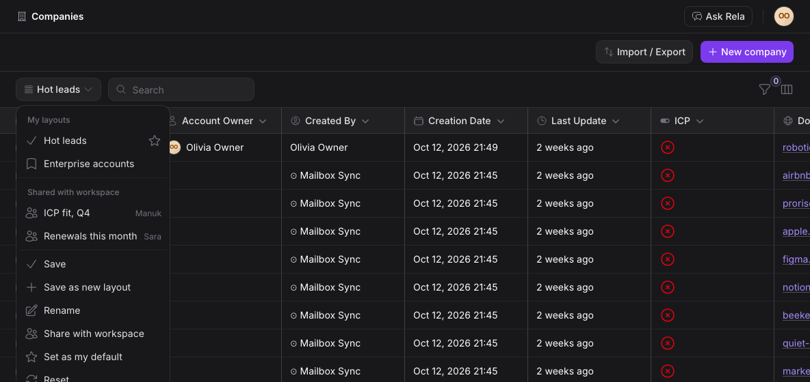

The control sits in the table toolbar, after search and before the filter trigger, through
`TablesRenderHook::TOOLBAR_SEARCH_AFTER` scoped to the five pages. The menu opens with "Standard
layout", the table as Filament defines it, then the member's own layouts, then the layouts shared
with the workspace. Each row leads with its type: a table icon for Standard layout, a bookmark for
a private layout, a group icon for a shared one. Its right edge carries its status: a star on the
layout that opens by default (Standard layout when the member has picked none), "Shared" on a layout
the member shares, and the owner's name on someone else's. The applied layout is tinted and
carries `aria-current`, so the tint is never the only signal.

Every action works on its own row, never on the applied layout alone. Hovering a row swaps its
status for a Delete button and a vertical `⋯` menu holding Rename, Share with workspace (or Stop
sharing) and Set as my default (or Remove as my default). Touch has no hover, so it shows status and
buttons together. Save lives only beside the trigger, where it appears once the layout is modified.
Save as new layout closes the menu in a group of its own. With no layout saved, the menu holds only
Standard layout and Save as new layout. Long names truncate in the trigger and the rows, with the
full name in a tooltip.

Sharing asks for confirmation first, because every member of the workspace sees the result. An
Admin stopping the share of someone else's layout is asked too, because the layout goes back to its
owner as a private one and leaves the Admin's list for good. Stopping the share of your own layout
needs no confirmation, since you can share it again.

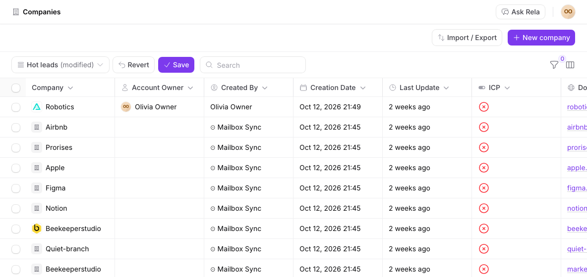

When the live state differs from the applied layout, the trigger reads "Hot leads (modified)" and
Revert and Save appear beside it. The comparison ignores widths, since layouts do not store them.

- Add `table_layouts` and the `active_layout_id` and `default_layout_id` columns on
  `table_preferences`.
- Actions in `app/Actions/TableLayouts/`: `CreateTableLayout`, `UpdateTableLayout` (rename, share,
  overwrite state), `DeleteTableLayout`, `SetDefaultTableLayout`, and `EnsureTableLayoutNameIsFree`,
  which the first two share. Each authorizes through the policy.
- `applySavedLayout()` on the trait follows the apply sequence below. The trait's save, save as
  new, rename, share, set-default and delete entry points each delegate to one of these
  actions and write nothing themselves.
- "Standard layout" returns the table to its default state and clears the active layout. There is
  no Reset: the member's default layout is one click away in the same list.
- All labels go through `__()` in `lang/en/filament/`.

What a member sees on opening a table:

1. At the start of a session, their default layout, when they have one. It is saved as their
   state, so the rest of the session keeps it until they change something.
2. Otherwise their last state. They see exactly what they left, with "(modified)" when they had
   changed an applied layout.
3. With neither, the table's default state.

A session starts at login, so a default is where each working day begins, while switching
layouts or changing the table during the day sticks. Members with no default keep their last
state across sessions.

When a shared layout changes under a member who has it applied or as their default:

| The owner or an Admin | The member's table | The member's pointers |
|---|---|---|
| overwrites it, and the member had not changed it | takes the new version on their next visit | unchanged |
| overwrites it, and the member had changed it | keeps the member's copy, still "(modified)" | unchanged |
| unshares or deletes it | keeps what it shows | active and default cleared |

To tell "had not changed it" apart, the preference row stores the hash of the layout state it
last applied. "Set as my default" may point at any layout the member can see, including someone
else's shared one. When the member can no longer see it, the default is cleared on load.

#### Telling the owner

When an Admin deletes or stops sharing a member's layout, the owner gets an in-app notice in the
bell. Without one, the layout simply vanishes from their menu, which reads as a bug.

| The Admin | The owner's notice |
|---|---|
| deletes the layout | ":actor deleted your layout "Renewals this quarter"", with the table it was on |
| stops sharing it | ":actor stopped sharing your layout "Renewals this quarter"", saying it is private to them again |
| renames or overwrites it | none |

- `TableLayoutChangedNotification` extends `InboxNotification`, with reason `System` and no
  preference toggle. Its subject is the workspace, as `PaymentFailedNotification`'s is. A deleted
  layout cannot be its subject: the notice is queued after commit, and `#[DeleteWhenMissingModels]`
  would drop it.
- The row stores facts, never a model: the layout's name, its entity and which change happened.
  `present()` renders them and links to that table's list page in the workspace.
- `DeleteTableLayout` and `UpdateTableLayout` send it, since an action owns its side effects.
  `UpdateTableLayout` sends it only when `is_shared` turns false.
- The actor is the Admin. `InboxNotification::shouldSend()` already skips a notice to its own
  actor and one to a member who has left the workspace, so the owner's own changes send nothing.
- In-app only, no email. A layout is low stakes, and the members who used it keep what their table
  shows.

Prove first: a render hook closure has no access to the page component. The control must still
mount the page's actions and call `applySavedLayout()`. Settle how before building the menu.

Done when:

- A layout applies columns, sort, filters, search, grouping and page size in one call, and the
  filter popover shows the applied filters.
- A layout holding a page size outside the table's options falls back to the default instead of
  applying.
- The permission rules below hold, each covered by a test.
- Changing the table after applying a layout shows "(modified)"; Revert restores the layout; Save
  overwrites it.
- An Admin who deletes or stops sharing a member's layout leaves one notice in that member's bell,
  and the owner's own changes leave none.

### Phase 4: Column menu and reorder

Each header gets an options button, and the header itself is dragged to reorder. Order and visibility
are state phase 2 already saves. Column labels add one field to `TableStateData`, which is JSON,
so this phase adds no migration.

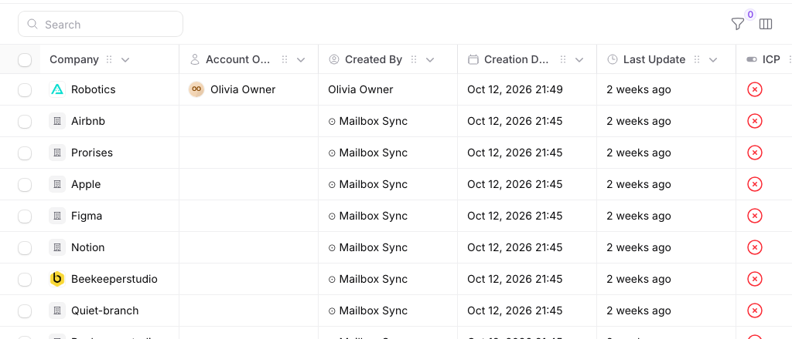
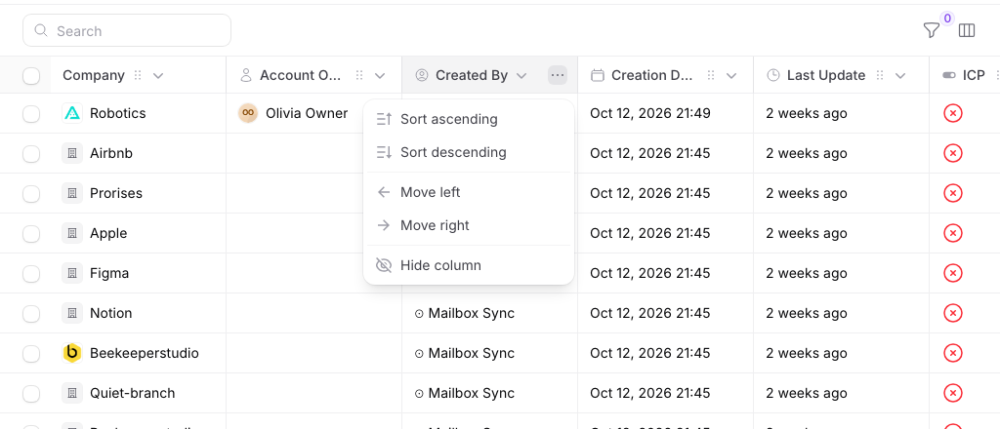

Every header always shows a `⋮` options button at its right edge.
Clicking it opens a menu with Move left and Move right, then Edit column label and Hide column.
Pressing anywhere else on the header and dragging reorders the column. The cursor there is the
move cursor, while the column name keeps the pointer cursor because a click on it still sorts:
a press only becomes a drag past 4px, and the click that ends a drag never sorts. Filament's sort
button is narrowed to the name so the rest of the header is free to grab. Dragging is off on
touch screens, where a swipe keeps scrolling the table and the menu moves the column. Sorting
stays on the header click and its chevron, so the menu does not repeat it. (The mockups show a
`⋯` button, a grip and a menu with the two sort items. A `⋮` button, a draggable header and a
shorter menu replaced them after the first build.) The script adds the button beside the resize
handle. One menu per table, rendered through `TablesRenderHook::TOOLBAR_SEARCH_AFTER` for the
five pages, opens under whichever options button was clicked. `TablesRenderHook::HEADER_CELL` was not used: it
replaces the whole `<th>`.

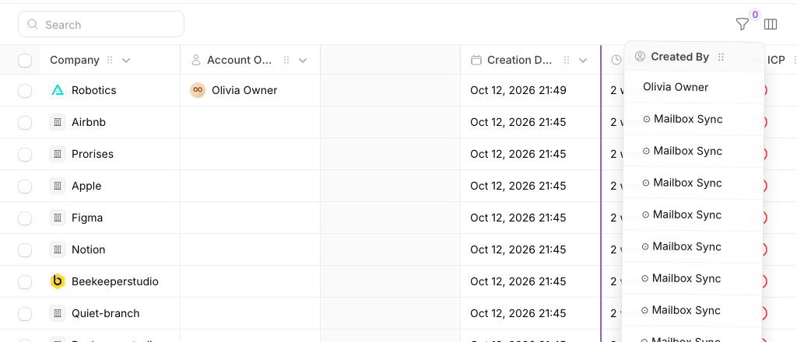

Dragging a header lifts the column. Its slot stays empty and travels with the drop position while
the other columns slide aside, so the table shows the new order before the drop. (The mockup's
drop line was replaced by this after the first build.) Holding the column near the table's left
or right edge scrolls the table sideways. A drop anywhere over the table calls one Livewire
method, `moveTableColumn()`, which reorders the column state through
`applyTableColumnManager(..., wasReordered: true)`. Move left and Move right call the same
method, and they are the keyboard path for reordering, as are the arrow keys on a focused options button.

- The drag lives in `resizable-columns.js`, beside the resize handles, so the two never fight
  over a mouse down on the header.
- Edit column label opens a modal with one field, filled with the name the column shows now. It
  renames the column for the member only: the header and the column manager show the new name,
  and exports, filters and other members keep the original. The name is kept in table state and
  in any layout saved from it, so applying a layout restores its labels and a changed label marks
  the layout "(modified)". At most 60 characters. Saving it empty, or saving the original name,
  removes the label. A label for a column the table no longer has is dropped on load.
- Hide appears only on toggleable columns. Move left and Move right are disabled at the edges.
- The title column (`CrmEntity::titleColumn()`) moves, drags and renames like any other column,
  because the column manager already let members move it before this phase. It is not
  toggleable, so its menu has no Hide.
- Every label goes through `__()`.

Done when:

- Edit column label, Move and Hide from the menu, and a drag, each change the table and survive
  a reload.
- The column manager's order and the header order always agree.
- The options button and its menu work by keyboard alone.

### Phase 5: Pinned columns

A member pins columns to the left edge. Pinned columns stay put while the rest of the table
scrolls sideways under them.

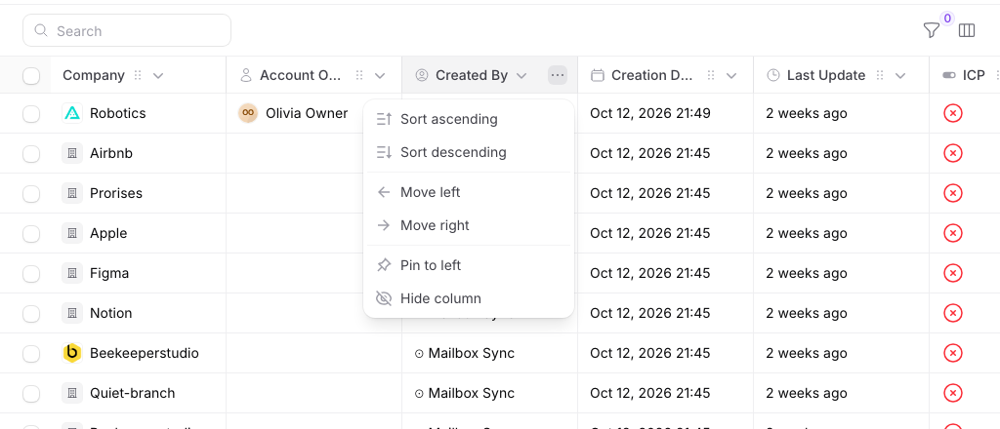
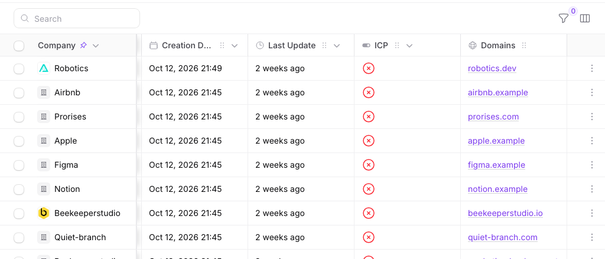
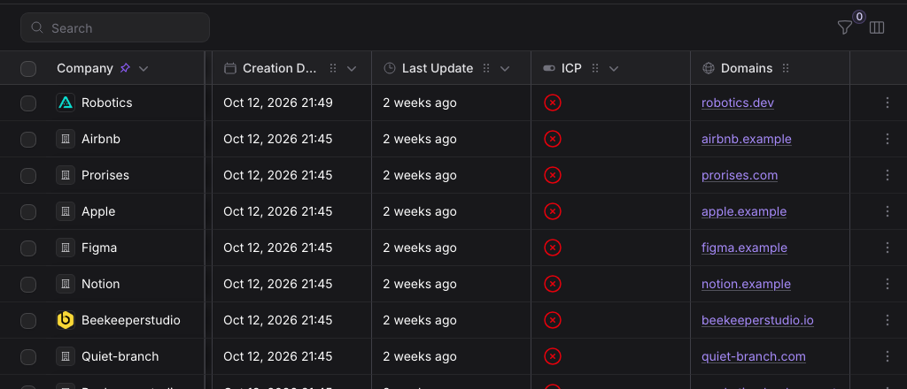

- The menu gains "Pin to left", shown as "Unpin" on a pinned column. A pinned header shows a
  pushpin beside its name.
- Pinned columns sit together at the left, after the selection checkbox, in pin order. Pinning
  moves a column there; unpinning returns it to the first unpinned position.
- The title column pins like any other column.
- The selection column is pinned whenever any column is.
- The last pinned column carries an edge shadow while the table is scrolled.
- Sticky positioning lives in `resizable-columns.js`, because that script owns cell styles (see
  phase 1). It recomputes offsets when a pinned column is resized.
- `TableStateData` gains `pinned`. Pins are saved in table state and in layouts.

Done when:

- A pin survives a reload and is restored by the layout it was saved in.
- Resizing a pinned column moves the columns pinned after it.
- Pinned cells paint above scrolled cells, row hovers and the selection state, in Chromium and
  WebKit, light and dark.

## Domain model

Two tables with ULID keys, matching the CRM convention. Both have factories.

### `table_preferences`: one row per member, per workspace, per table

| Column | Type | Notes |
|---|---|---|
| `id` | ulid | primary key |
| `workspace_id` | ulid | foreign key, cascade on delete |
| `user_id` | ulid | foreign key, cascade on delete |
| `entity` | string | a `CrmEntity` value, cast to the enum |
| `state` | jsonb | a `TableStateData` |
| `active_layout_id` | ulid, nullable | phase 3; foreign key to `table_layouts`, null on delete |
| `default_layout_id` | ulid, nullable | phase 3; foreign key to `table_layouts`, null on delete |
| `applied_layout_hash` | string, nullable | phase 3; hash of the layout state last applied, to tell a clean copy from a changed one |
| `created_at`, `updated_at` | timestamp | |

Unique on `(user_id, workspace_id, entity)`.

### `table_layouts`: one row per saved layout (phase 3)

| Column | Type | Notes |
|---|---|---|
| `id` | ulid | primary key |
| `workspace_id` | ulid | foreign key, cascade on delete |
| `user_id` | ulid | the owner; foreign key, cascade on delete |
| `entity` | string | a `CrmEntity` value, cast to the enum |
| `name` | string | unique per owner per table, ignoring case |
| `is_shared` | boolean | default false |
| `state` | jsonb | a `TableStateData`, without widths |
| `created_at`, `updated_at` | timestamp | |

Unique on `(user_id, workspace_id, entity, lower(name))`, so "Hot leads" and "hot leads" clash.
Index on `(workspace_id, entity)`.

### Relationships

```
Workspace 1 ──< TablePreference >── 1 User
Workspace 1 ──< TableLayout       >── 1 User (owner)
TablePreference ── active_layout  ──> 0..1 TableLayout
TablePreference ── default_layout ──> 0..1 TableLayout
```

Both models carry `WorkspaceScope`, like the CRM models, and the code that reads them also
filters by user explicitly.

### `TableStateData`

A spatie/laravel-data object in `app/Data/`, serialized into both `state` columns. It is
rebuilt from stored JSON, which is the case `architecture.md` assigns to laravel-data.

| Field | Shape | Since |
|---|---|---|
| `columns` | ordered list of `{type, name, isToggled}` | 2 |
| `sort` | `"{column}:{direction}"` or null | 2 |
| `filters` | the raw filter form state | 2 |
| `search` | string or null | 2 |
| `columnSearches` | map of column to term | 2 |
| `grouping` | `"{group}:{direction}"` or null | 2 |
| `perPage` | int or `"all"` | 2 |
| `widths` | map of column to pixels; preferences only | 2 |
| `labels` | map of column to the member's name for it, at most 60 characters | 4 |
| `pinned` | ordered list of column names | 5 |

A field added later defaults to empty, so a row saved before it loads unchanged.

### Self-healing

State stores column names, and custom field columns come and go. On load, a column the table no
longer has is dropped and a column the state does not know is appended with its default
visibility. The same applies to filters, pins and widths. Filament's
`syncReorderableColumnsFromDefaultTableColumnState()` already does this for columns. A filter
key for a deleted custom field is re-filled into the form and ignored by the query; the
implementation asserts this rather than assuming it.

Healing happens in memory. The row is rewritten only when the member next changes something.

## Permissions

`TableLayoutPolicy`. It does not reuse `ChecksWorkspaceWriteAccess`: that trait excludes Viewers,
and a layout touches no CRM data.

| Who | Own private layout | Own shared layout | Someone else's shared layout | Someone else's private layout |
|---|---|---|---|---|
| Any member, Viewers included | see, edit, delete | see, edit, delete | see, apply | nothing |
| Workspace Admin | see, edit, delete | see, edit, delete | see, apply, edit, delete | nothing |

Any member may create and share a layout. When a member leaves the workspace, their preferences
and private layouts stay unused, and their shared layouts stay visible and manageable by Admins.

## Filament internals

Verified against `filament/tables` v5.9.0 by #944, and again on 2026-10-28.
Re-verify if it changes. Method names are stable references; line numbers are not.

- **Every session write is gated.** Each `session()->put` for table state sits behind a
  `persists*InSession()` check, both in the restore block of `bootedInteractsWithTable()` and in
  the update hooks: `HasFilters::handleTableFilterUpdates()`, `CanSortRecords::updatedTableSort()`
  and `updatedTableSortDirection()`, `CanSearchRecords::updatedTableSearch()` and
  `updatedTableColumnSearches()`, `CanGroupRecords::updatedTableGrouping()`,
  `CanPaginateRecords::updatedTableRecordsPerPage()`, and `HasColumnManager::persistTableColumns()`
  and `persistHasReorderedTableColumns()`.
- **Two of the seven flags default to true.** `persistsColumnsInSession` (`HasColumnManager`) and
  `persistsRecordsPerPageInSession` (`CanPaginateRecords`). Filters, sort, search, column
  searches and grouping default to false, and nothing in `app/` turns them on. So today only
  column state and page size survive within a session, and phase 2 is new behaviour for the
  rest. `persistColumnsInSession(false)` in `AppPanelProvider` turns off the column flag, so
  Filament writes only page size to the session.
- **Columns need one override.** With session persistence off,
  `loadTableColumnsFromSession()` returns the default column state and `persistTableColumns()`
  does nothing, so the override replaces the method body rather than wrapping `parent::`.
  `initTableColumnManager()` calls it only when `tableColumns` is blank, which is the first mount.
  `applyTableColumnManager(?array $state, bool $wasReordered)` is the public apply entry point.
- **A saved column order survives without the session.** Filament keeps the member's order only
  when a reorder flag is set, and otherwise resets to the default order. With session persistence
  on, that flag lives in the session. With it off, `applyTableColumnManager()` derives it from
  `$wasReordered || hasReorderedTableColumns()`, so the stored order holds.
- **State shapes.** `tableSort` is `"{column}:{direction}"`, `tableGrouping` is
  `"{groupId}:{direction}"`, `tableFilters` is the raw filter form state, `tableRecordsPerPage`
  is an int or `all`, and `tableColumns` is an ordered list of column descriptors. Only `type`,
  `name` and `isToggled` are stored; the rest is re-derived from the live column.
- **Mount ordering.** Livewire runs `boot`, `bootTrait`, `initializeTrait`, `mount`, `mountTrait`,
  `booted` and `bootedTrait`, and `#[Url]` values land before all of them. So
  `mountInteractsWithTable()` runs after the URL values and before the restore block in
  `bootedInteractsWithTable()`. That makes it the seeding hook, with two constraints. The table
  is built in `bootedInteractsWithTable()`, so `getTable()` is not available yet and the seed
  assigns raw values only. Each restore step runs only when its property is blank, so a seeded
  value stops Filament from overwriting it.
- **No remount is needed to apply a layout.** `ListRecords` binds filters, sort, search, grouping
  and the active tab to the query string in replace mode, so a server-side assignment rewrites
  the URL in place.
- **Page size is not validated at runtime.** Only the mount-time default checks it against
  `getPaginationPageOptions()`, so the apply path validates it.

## Apply sequence

Order matters. `applySavedLayout()`:

1. `applyTableColumnManager($columns, wasReordered: true)` first: it flushes the cached visible
   columns that sort and search validity depend on.
2. `$this->tableSort = ...`, then `updatedTableSort()`.
3. `$this->tableGrouping = ...`, then `updatedTableGrouping()`.
4. Search: assign and call `updatedTableSearch()`, or `resetTableSearch()` when the layout has
   none.
5. Column searches: assign and call `updatedTableColumnSearches()`, or
   `resetTableColumnSearches()`.
6. Page size: validate against `getPaginationPageOptions()`, fall back to
   `getDefaultTableRecordsPerPageSelectOption()`, assign, then `updatedTableRecordsPerPage()`.
7. `getTableFiltersForm()->fill($filters)`: the popover does not rehydrate itself, and without
   this it shows stale filters.
8. `applyTableFilters()`.
9. `flushCachedTableRecords()` if records were already resolved this request.
10. Phase 5: apply pins.

Never call `resetTable()`: it re-runs the whole booted block and blanks the filter form.

## Edge cases

- **Two tabs.** The last write wins. Accepted.
- **Shared URL.** Query-string sort, filters and search win over saved state on mount.
- **Workspace isolation.** Every row carries `workspace_id`, and with session persistence off
  Filament keeps no copy that could cross workspaces.
- **Column groups.** A `ColumnGroup` has no key, only a label. `mapTableColumnGroupToArray()`
  stores the escaped, translated label as its name, so a group saved in one language does not
  match in another and loses its settings. None of the five tables has one. If one is added,
  match a stored group by the column names inside it.

## Code layout

| Path | Holds | Phase |
|---|---|---|
| `app/Filament/Tables/Concerns/HasResizableColumns.php` | resize trait | 1 |
| `app/Filament/Tables/ResizableColumns.php` | gives every column its width and drag handle | 1 |
| `app/Providers/MacroServiceProvider.php` | registers `Table::resizableColumns()` | 1 |
| `stubs/Filament.stub` | types the macro and its `$this` for PHPStan | 1 |
| `resources/js/filament/resizable-columns.js` | resize, then drag, then sticky | 1, 4, 5 |
| `app/Filament/Tables/Concerns/PersistsTableState.php` | state trait | 2 |
| `app/Models/TablePreference.php`, `app/Models/TableLayout.php` | models | 2, 3 |
| `app/Data/TableStateData.php` | state object | 2 |
| `app/Actions/TableLayouts/` | `SaveTablePreference`, layout actions | 2, 3 |
| `app/Policies/TableLayoutPolicy.php` | policy | 3 |

## Tests

Feature tests through `livewire(ListCompanies::class)` and the other four pages, in
`tests/Feature/Filament/App/Resources/`. One browser test per phase for the interaction a
feature test cannot reach (dragging, the toolbar menu, sticky scrolling), run in Chromium and
WebKit. No migration tests: rehearse each migration on anonymized production data, per
`core.md`.

## Left to the builder

- How the toolbar control reaches the page component (phase 3, proved first).
- The exact markup and styling, within the mockups and the theme variables.
- Where the drag threshold sits, and the drag behaviour on touch screens.
- What happens when pinned columns are wider than the viewport. The table must stay usable on a
  narrow screen.
